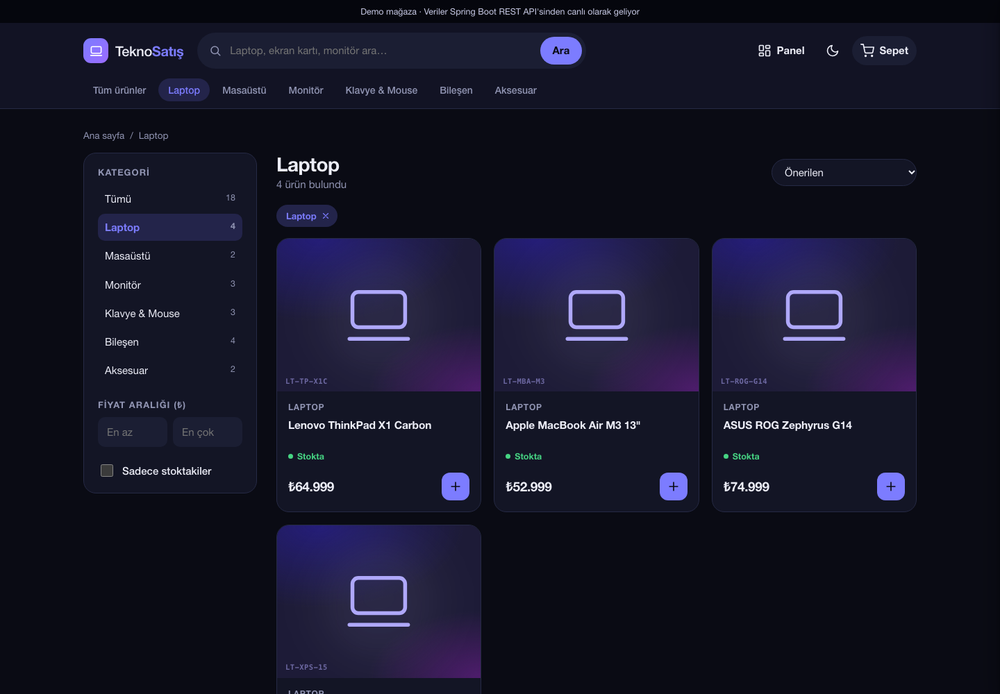
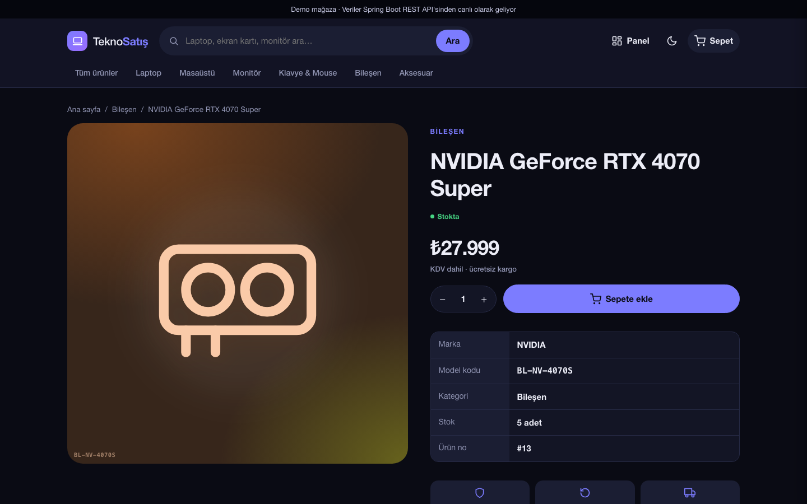
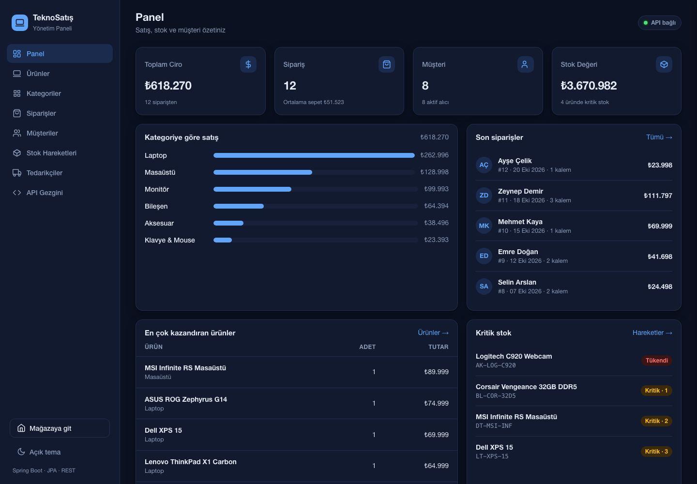
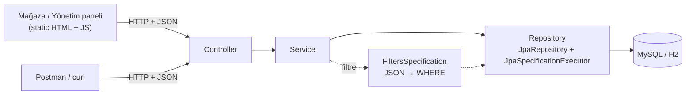
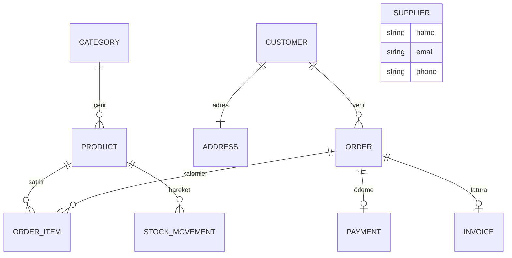

# 🖥️ Computer Sales System

Bilgisayar ve donanım satışı için geliştirilmiş bir **Spring Boot REST API**. Yanında bu API'yi kullanan bir **müşteri mağazası** ve bir **yönetim paneli** de var.

Projenin öne çıkan özelliği **dinamik filtreleme**: Tek bir uç noktaya gönderilen JSON, JPA Specification ile SQL sorgusuna çevrilir. Bu sayede 10 farklı kaynak, ek kod yazmadan aranabilir, sıralanabilir ve sayfalanabilir.

[](https://github.com/yakupceri/computer-sales-system-spring-boot/actions/workflows/ci.yml)


---

## İçindekiler

- [Özellikler](#-özellikler)
- [Ekran görüntüleri](#-ekran-görüntüleri)
- [Hızlı başlangıç](#-hızlı-başlangıç)
- [API](#-api)
- [Dinamik filtreleme](#-dinamik-filtreleme)
- [Mimari](#-mimari)
- [Veri modeli](#-veri-modeli)
- [Testler](#-testler)
- [Yol haritası](#-yol-haritası)

---

## ✨ Özellikler

**Backend**
- 10 kaynak için REST uç noktaları: ürün, kategori, müşteri, adres, sipariş, sipariş kalemi, ödeme, fatura, stok hareketi, tedarikçi
- **Dinamik filtreleme** (JPA Specification): `EQUAL`, `LIKE`, `GREATER_THAN`, `LESS_THAN`, ilişkili tablolarda `join`, `AND` / `OR` birleştirme
- Filtre değerleri alanın gerçek tipine çevrilir. Böylece `"1000"` gibi bir değer `BigDecimal` olarak karşılaştırılır, metin olarak değil.
- Geçersiz kolon, eksik alan ve yanlış tipteki değerler için anlaşılır hata mesajları
- Sayfalama ve sıralama (`page`, `size`, `sort`)
- Kategoriler için tam **CRUD**: listeleme, getirme, ekleme, güncelleme, silme. Doğru HTTP kodları döner: `201`, `204`, `400`, `404`, `409`.
- `@Valid` ile doğrulama; aynı isimde kategori ve ürünü olan kategoriyi silme `409 Conflict` ile reddedilir.
- Ürünler için CRUD. İstekler entity yerine **DTO** (`ProductRequest`) ile alınır; SKU tekrarı `409`, olmayan kategori `400` döner.
- **Sipariş oluşturma** (`POST /api/orders`): stok kontrolü, stok düşme, `OUT` stok hareketi, satış anındaki fiyatla sipariş kalemleri ve toplam tutar **tek transaction** içinde yapılır. Stok yetmezse tüm sipariş geri alınır (`409`). Eşzamanlı siparişlerde aynı ürünün fazla satılmaması için satır kilidi (`PESSIMISTIC_WRITE`) kullanılır.
- Katmanlı mimari: Controller → Service → Repository
- İki veritabanı profili: **MySQL** (varsayılan) ve kurulum gerektirmeyen **H2** (örnek veriyle birlikte)

**Mağaza** (`/`)
- Ana sayfa: haftanın ürünü, kategoriler, çok satanlar, yeni gelenler
- Ürün listesi: kategori, fiyat aralığı ve stok filtreleri, sıralama, sayfalama. Hepsi sunucu tarafında, dinamik filtre API'siyle çalışır.
- Ürün detayı ve benzer ürünler
- Sepet ve gerçek sipariş: "Siparişi tamamla" butonu `POST /api/orders` ucuna gider, stoklar anında güncellenir
- Açık/koyu tema, mobil uyumlu tasarım

**Yönetim paneli** (`/panel.html`)
- Ciro, sipariş, müşteri ve stok değeri özetleri; kategoriye göre satış grafiği
- Kategori ekleme, düzenleme ve silme formu
- Ürün, sipariş, müşteri, stok hareketi ve tedarikçi ekranları
- **API Gezgini:** filtre isteklerini tarayıcıdan gönderip cevabı görme

> Arayüzler bağımlılık kullanmayan HTML, CSS ve JavaScript ile yazıldı. Spring Boot bunları `src/main/resources/static` klasöründen sunar; ayrı bir frontend sunucusuna gerek yoktur.

---

## 📸 Ekran görüntüleri

| Ürün listesi ve filtreler | Ürün detayı |
|---|---|
|  |  |

**Yönetim paneli**



---

## 🚀 Hızlı başlangıç

### Gereksinimler
- **Java 25**
- Maven kurmana gerek yok, projedeki `./mvnw` yeterli.
- MySQL sadece MySQL profiliyle çalıştırırken gerekli.

### 1. Demo modu (önerilen, kurulum gerekmez)

H2 bellek içi veritabanını kullanır. Uygulama her açılışta örnek veriyi yükler: 6 kategori, 18 ürün, 8 müşteri, 12 sipariş ve ilgili ödeme, fatura ve stok kayıtları.

```bash
git clone https://github.com/yakupceri/computer-sales-system-spring-boot.git
cd computer-sales-system-spring-boot
./mvnw spring-boot:run -Dspring-boot.run.profiles=h2
```

| Adres | Ne var? |
|---|---|
| http://localhost:8080 | Mağaza |
| http://localhost:8080/panel.html | Yönetim paneli |
| http://localhost:8080/h2-console | Veritabanı konsolu (JDBC URL: `jdbc:h2:mem:computer_sales`, kullanıcı: `sa`, şifre boş) |

> H2 verileri bellekte tutar. Uygulama kapanınca veriler silinir, bir sonraki açılışta örnek veri yeniden yüklenir.

### 2. MySQL ile

Önce bir `computer_sales` veritabanı oluştur. Tablolar ilk çalıştırmada otomatik oluşturulur (`ddl-auto=update`). Bağlantı bilgileri ortam değişkenlerinden okunur:

```bash
export DB_PASSWORD=sifren
export DB_USERNAME=root                                    # varsayılan: root
export DB_URL=jdbc:mysql://localhost:3306/computer_sales   # varsayılan bu adres
./mvnw spring-boot:run
```

---

## 🔌 API

Tüm uçlar `/api` altında.

| Metot | Uç nokta | Açıklama |
|---|---|---|
| `GET` | `/api/categories` | Tüm kategoriler |
| `GET` | `/api/categories/{id}` | Tek kategori. Bulunamazsa `404` döner. |
| `POST` | `/api/categories` | Kategori ekler, `201 Created` döner |
| `PUT` | `/api/categories/{id}` | Kategoriyi günceller |
| `DELETE` | `/api/categories/{id}` | Kategoriyi siler, `204 No Content` döner. Bağlı ürün varsa `409`. |
| `GET` | `/api/products/{id}` | Tek ürün |
| `POST` | `/api/products` | Ürün ekler (`name`, `sku`, `price`, `stockQuantity`, `categoryId`) |
| `PUT` | `/api/products/{id}` | Ürünü günceller |
| `DELETE` | `/api/products/{id}` | Ürünü siler. Satılmış ürünler silinemez (`409`). |
| `POST` | `/api/orders` | Sipariş oluşturur, stoğu düşer → `201` |
| `GET` | `/api/orders/{id}` | Tek sipariş (kalemleriyle) |
| `POST` | `/api/{kaynak}/filter` | Dinamik filtreyle liste |
| `POST` | `/api/{kaynak}/filter-page?page=0&size=10&sort=alan,asc` | Dinamik filtre, sayfalama ve sıralama |

```bash
# Yeni kategori ekle
curl -X POST http://localhost:8080/api/categories \
  -H "Content-Type: application/json" \
  -d '{"name":"Tablet","description":"Tablet bilgisayarlar"}'
# → 201 Created  {"id":7,"name":"Tablet","description":"Tablet bilgisayarlar"}

# Sipariş oluştur: 1 numaralı müşteri, 15 numaralı üründen 2 adet
curl -X POST http://localhost:8080/api/orders \
  -H "Content-Type: application/json" \
  -d '{"customerId":1,"items":[{"productId":15,"quantity":2}]}'
# → 201 Created, ürünün stoğu 2 azalır. Stok yetmezse 409 ve hiçbir değişiklik kaydedilmez.
```

`{kaynak}` şunlardan biri olabilir:
`products` · `categories` · `customers` · `addresses` · `orders` · `order-items` · `payments` · `invoices` · `stock-movements` · `suppliers`

---

## 🔍 Dinamik filtreleme

Filtre isteği bir koşul listesinden oluşur. Her koşul bir kolon, bir operasyon ve bir değer içerir:

```json
{
  "globalOperator": "AND",
  "searchRequestDto": [
    { "column": "name",  "operation": "LIKE",         "value": "lenovo" },
    { "column": "price", "operation": "GREATER_THAN", "value": 30000 },
    { "join": "category", "column": "name", "operation": "EQUAL", "value": "Laptop" }
  ]
}
```

| Alan | Açıklama |
|---|---|
| `column` | Entity'deki alan adı (`name`, `price`, `stockQuantity`…) |
| `operation` | `EQUAL`, `LIKE` (büyük/küçük harf duyarsız), `GREATER_THAN`, `LESS_THAN` |
| `value` | Aranan değer. Alanın tipine otomatik çevrilir. `EQUAL` ile `null` gönderilirse `IS NULL` sorgusu yapılır. |
| `join` | *(opsiyonel)* İlişkili entity üzerinden filtrelemek için ilişki adı. Örneğin `category` |
| `globalOperator` | Koşulları `AND` (varsayılan) ya da `OR` ile birleştirir |

Filtre listesi boş gönderilirse (`{}`) tüm kayıtlar döner.

### Örnekler

```bash
# Adında "lenovo" geçen, 30.000 ₺ üstü laptoplar
curl -X POST http://localhost:8080/api/products/filter \
  -H "Content-Type: application/json" \
  -d '{"searchRequestDto":[
        {"column":"name","operation":"LIKE","value":"lenovo"},
        {"column":"price","operation":"GREATER_THAN","value":30000},
        {"join":"category","column":"name","operation":"EQUAL","value":"Laptop"}]}'
```

```bash
# Monitörler, fiyata göre azalan, sayfa başına 5 kayıt
curl -X POST "http://localhost:8080/api/products/filter-page?page=0&size=5&sort=price,desc" \
  -H "Content-Type: application/json" \
  -d '{"searchRequestDto":[{"join":"category","column":"name","operation":"EQUAL","value":"Monitör"}]}'
```

```bash
# Laptop kategorisindekiler VEYA 3.000 ₺ altındakiler
curl -X POST http://localhost:8080/api/products/filter \
  -H "Content-Type: application/json" \
  -d '{"globalOperator":"OR","searchRequestDto":[
        {"join":"category","column":"name","operation":"EQUAL","value":"Laptop"},
        {"column":"price","operation":"LESS_THAN","value":3000}]}'
```

Olmayan bir kolon gönderilirse istek reddedilir ve hangi kolonun sorunlu olduğu söylenir:

```json
{ "status": 500, "message": "Geçersiz kolon: fiyat" }
```

---

## 🏗️ Mimari



```
src/main/java/com/yakup/sales
├── controller/      REST uç noktaları (her kaynak için bir controller)
├── service/         İş mantığı; IBaseFilterService ile ortak filtre davranışı
├── repository/      Spring Data JPA repository'leri
├── specification/   FiltersSpecification: filtre isteğini JPA Specification'a çevirir
├── dto/             RequestDto, SearchRequestDto
└── domain/          JPA entity'leri

src/main/resources
├── static/          Mağaza (index.html) ve yönetim paneli (panel.html)
├── application.properties       MySQL ayarları
├── application-h2.properties    H2 demo profili
└── data-h2.sql                  Demo verisi
```

Filtreleme, `IBaseFilterService` arayüzündeki `default` metot sayesinde 10 servis tarafından ortak kullanılır. Yeni bir kaynağın aranabilir olması için repository'nin `JpaSpecificationExecutor`'ı genişletmesi yeterlidir.

---

## 🗂️ Veri modeli



---

## 🧪 Testler

```bash
./mvnw test
```

- `FiltersSpecificationTest`: Dinamik filtrenin sayısal karşılaştırma, `LIKE`, `join`, boş filtre ve hatalı istek davranışlarını H2 üzerinde test eder.
- `CategoryControllerTest`: Kategori CRUD uçlarını MockMvc ile uçtan uca test eder (201, 400, 404, 409, 204).
- `ProductControllerTest`: Ürün CRUD'u, SKU tekrarı, geçersiz alanlar ve satılmış ürünü silme.
- `OrderControllerTest`: Sipariş oluşturma, stok düşmesi, aynı ürünün satırlarını birleştirme, **yetersiz stokta rollback** ve hatalı istekler.
- `ComputerSalesSystemApplicationTests`: Uygulamanın H2 profiliyle ayağa kalktığını doğrular.

---

## 🗺️ Yol haritası

- [x] Dinamik filtreleme, sayfalama ve sıralama
- [x] Kategoriler için CRUD (`POST`, `PUT`, `DELETE`), doğrulama ve anlamlı HTTP kodları
- [x] H2 demo profili ve örnek veri
- [x] Müşteri mağazası ve yönetim paneli
- [x] Ürünler için CRUD ve request DTO'ları
- [x] Transactional sipariş oluşturma (stok kontrolü, stok düşme, stok hareketi, toplam hesaplama) ve mağazaya bağlanması
- [ ] Müşteri, tedarikçi gibi diğer kaynaklar için ekleme, güncelleme ve silme uçları
- [ ] Siparişe ödeme ve fatura kaydının eklenmesi
- [ ] Response DTO'ları (şu an cevaplarda entity'ler dönüyor)
- [ ] `@RestControllerAdvice` ile global hata yönetimi. Hatalı filtrelerin `400` dönmesi de bu adımda gelecek.
- [ ] OpenAPI / Swagger dokümantasyonu
- [ ] Spring Security ile kimlik doğrulama

---

## 📚 Ders notları

Bu proje üzerinde Spring Boot öğrenirken sorduğum sorular ve cevapları [`ders-notlari/`](ders-notlari/) klasöründe ([PDF](ders-notlari/Spring-Boot-Ders-Notlari.pdf)).

---

## 📄 Lisans

[MIT](LICENSE)
